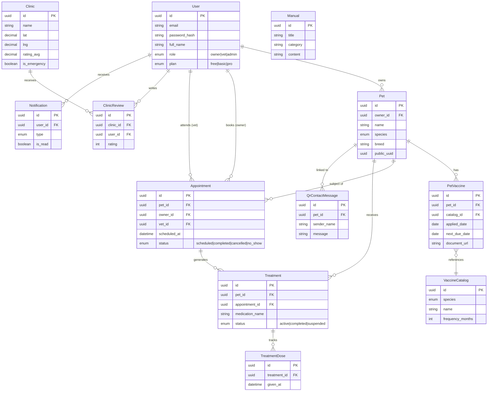

# PetCare — Documentación Completa

## Tabla de Contenidos
1. [Arquitectura del Sistema](#11-arquitectura-del-sistema)
2. [Guía de Instalación](#12-guía-de-instalación-y-configuración)
3. [Estructura del Proyecto](#13-estructura-del-proyecto)
4. [API Reference](#14-api-reference)
5. [Despliegue](#15-despliegue-deploy)
6. [Diagrama ERD](#16-diagrama-de-base-de-datos-erd)
7. [Flujos de Autenticación](#17-flujos-de-autenticación)
8. [Tabla de Actores y Funciones](#18-tabla-de-actores-y-funciones)
9. [Manual de Usuario — Dueños](#2a--manual-para-dueños-de-mascotas)
10. [Manual de Usuario — Veterinarios](#2b--manual-para-veterinarios--clínicas)
11. [Troubleshooting](#31-errores-comunes)
12. [Buenas Prácticas](#32-buenas-prácticas)
13. [Changelog](#sección-5--changelog--historial-de-versiones)
14. [Guía de Contribución](#sección-6--guía-de-contribución)
15. [Guía de Tests](#sección-7--guía-de-tests)
16. [Glosario](#sección-4--glosario-de-términos)

---

# SECCIÓN 1 — Documentación Técnica

## 1.1 Arquitectura del Sistema

PetCare sigue una arquitectura **monolito modular** con separación clara entre capas. El frontend es una SPA (Vanilla JS) servida por el mismo servidor Express. Todas las peticiones al API pasan por middlewares de autenticación JWT antes de llegar a los controladores de ruta.

```mermaid
graph TD
    A[Usuario / Navegador SPA] -->|HTTP + JWT Bearer| B[Express.js Server]
    C[App Android Capacitor] -->|HTTP + JWT Bearer| B
    B --> D{Router}
    D --> E[/api/auth]
    D --> F[/api/pets]
    D --> G[/api/appointments]
    D --> H[/api/clinics]
    D --> I[/api/triage]
    E & F & G & H & I --> J[Middleware JWT requireAuth]
    J --> K[(PostgreSQL via Prisma ORM)]
    F --> L[GCS / Cloudinary — Fotos]
    H --> M[Google Maps API]
    I --> N[Anthropic Claude AI]
    B --> O[/public/index.html SPA Fallback]
```

**Flujo de datos resumido:**
1. El cliente envía un `Authorization: Bearer <token>` en cada petición protegida.
2. El middleware `requireAuth` verifica y decodifica el JWT.
3. El router correspondiente ejecuta la lógica de negocio con queries a PostgreSQL via Prisma/pool.
4. Los archivos binarios (fotos) se procesan con Multer + Sharp y se suben a GCS/Cloudinary; se guarda solo la URL en la BD.
5. El mapa de clínicas obtiene la API Key de Maps desde el backend autenticado (nunca expuesta en HTML).

---

## 1.2 Guía de Instalación y Configuración

### Prerrequisitos

| Herramienta | Versión mínima | Notas |
|-------------|---------------|-------|
| Node.js | v18.x | Recomendado v20 LTS |
| PostgreSQL | v14 | Con extensiones `uuid-ossp` y `pg_trgm` |
| npm | v9+ | Incluido con Node.js |
| Git | Cualquiera reciente | Para clonar el repositorio |

### Paso 1 — Clonar el repositorio

```bash
git clone https://github.com/danielbau200/PetCare.git
cd PetCare
```

### Paso 2 — Instalar dependencias

```bash
npm install
```
> El `postinstall` ejecuta `prisma generate` automáticamente.

### Paso 3 — Configurar variables de entorno

```bash
cp .env.example .env
# Editar .env con tus valores reales
```

| Variable | Descripción | Obligatoria |
|----------|-------------|:-----------:|
| `PORT` | Puerto del servidor (default: 3000) | No |
| `NODE_ENV` | `development` o `production` | No |
| `DATABASE_URL` | Connection string PostgreSQL (con pooler si usas Neon) | ✅ |
| `DIRECT_URL` | Connection string directo (sin pooler) para migraciones | ✅ |
| `JWT_SECRET` | Clave secreta para firmar tokens JWT | ✅ |
| `JWT_EXPIRES_IN` | Duración del token (default: `7d`) | No |
| `GOOGLE_APPLICATION_CREDENTIALS` | Ruta al JSON del Service Account de GCP | Si usas GCS |
| `GCS_BUCKET_NAME` | Nombre del bucket de Google Cloud Storage | Si usas GCS |
| `GCS_PROJECT_ID` | ID del proyecto en GCP | Si usas GCS |
| `GOOGLE_MAPS_API_KEY` | API Key de Google Maps Platform | ✅ |
| `FRONTEND_URL` | URL base del frontend (para OAuth redirects) | ✅ |
| `ALLOWED_ORIGINS` | Dominios permitidos para CORS (separados por coma) | ✅ |
| `PUBLIC_URL` | URL pública del servidor (para QR y emails) | ✅ |
| `RATE_LIMIT_WINDOW_MS` | Ventana de rate limit en ms (default: 900000) | No |
| `RATE_LIMIT_MAX` | Máx. requests por ventana (default: 200) | No |

### Paso 4 — Configurar PostgreSQL

```sql
-- Como superusuario:
CREATE DATABASE petcare_db;
CREATE USER petcare_user WITH ENCRYPTED PASSWORD 'contraseña_segura';
GRANT ALL PRIVILEGES ON DATABASE petcare_db TO petcare_user;
\c petcare_db
CREATE EXTENSION IF NOT EXISTS "uuid-ossp";
CREATE EXTENSION IF NOT EXISTS "pg_trgm";
```

### Paso 5 — Ejecutar migraciones

```bash
npx prisma generate      # Genera el cliente de Prisma
npx prisma migrate deploy  # Aplica migraciones en la BD
npm run seed             # Opcional: carga catálogo de vacunas y manuales
```

### Paso 6 — Iniciar en desarrollo

```bash
npm run dev
# Servidor en http://localhost:3000
```

---

## 1.3 Estructura del Proyecto

```
petcare-manager/
├── src/
│   ├── server.js              ← Entrada principal: Express, middlewares, rutas
│   ├── config/
│   │   ├── database.js        ← Pool de conexión PostgreSQL (pg)
│   │   ├── storage.js         ← GCS / Cloudinary: upload, delete, verify
│   │   ├── passport.js        ← Estrategia Google OAuth2 (Passport.js)
│   │   └── mailer.js          ← Nodemailer: envío de emails y generación de códigos
│   ├── middleware/
│   │   ├── auth.js            ← requireAuth, requireVet, requireAdmin, generateToken
│   │   └── upload.js          ← Multer en memoria + Sharp (resize/WebP) → Storage
│   ├── routes/
│   │   ├── auth.js            ← Registro, login, OAuth Google, perfil, sesiones
│   │   ├── pets.js            ← CRUD mascotas, foto, placa QR STL
│   │   ├── vaccines.js        ← Cartilla digital + catálogo por especie
│   │   ├── appointments.js    ← Citas: CRUD + generación de receta PDF
│   │   ├── treatments.js      ← Tratamientos activos + log de dosis
│   │   ├── clinics.js         ← Clínicas con búsqueda geoespacial + reseñas
│   │   ├── manuals.js         ← Manuales preventivos + notificaciones
│   │   ├── triage.js          ← IA de triage con Anthropic Claude
│   │   └── public.js          ← Endpoints públicos (perfil QR de emergencia)
│   └── utils/
│       └── stlGenerator.js    ← Generador de placas 3D STL con QR en relieve
├── prisma/
│   └── schema.prisma          ← Definición completa de modelos y relaciones
├── migrations/
│   ├── 001_schema.sql         ← Esquema SQL base (45 casos de uso)
│   ├── 002_seed.sql           ← Catálogos iniciales (vacunas, manuales)
│   └── run.js                 ← Runner de migraciones SQL
├── frontend/
│   └── index.html             ← SPA completa (desarrollo)
├── public/
│   └── index.html             ← SPA compilada (producción)
├── scripts/
│   └── build.js               ← Script que copia frontend/ → public/
├── android/                   ← Proyecto Android generado por Capacitor
├── .env.example               ← Plantilla de variables de entorno
├── package.json
├── Dockerfile                 ← Imagen Docker para self-hosting
├── railway.json               ← Config de despliegue en Railway
└── capacitor.config.json      ← Config de Capacitor para móvil
```

---

## 1.4 API Reference

> **Header requerido en todos los endpoints protegidos:**
> `Authorization: Bearer <token>`

### Auth — `/api/auth`

#### `POST /api/auth/register`
Crea una nueva cuenta de usuario.

**Body:**
| Campo | Tipo | Obligatorio | Descripción |
|-------|------|:-----------:|-------------|
| `email` | string | ✅ | Correo electrónico único |
| `password` | string | ✅ | Mínimo 8 caracteres |
| `full_name` | string | ✅ | Nombre completo |
| `phone` | string | No | Teléfono de contacto |
| `role` | string | No | `owner` (default) o `vet` |

**Request:**
```json
{
  "email": "juan@ejemplo.com",
  "password": "miPass2024!",
  "full_name": "Juan Pérez",
  "phone": "8441234567",
  "role": "owner"
}
```

**Response `201 Created`:**
```json
{
  "user": {
    "id": "a1b2c3d4-e5f6-7890-abcd-ef1234567890",
    "email": "juan@ejemplo.com",
    "full_name": "Juan Pérez",
    "role": "owner",
    "plan": "free",
    "created_at": "2026-05-26T03:00:00.000Z"
  },
  "token": "eyJhbGciOiJIUzI1NiIsInR5cCI6IkpXVCJ9..."
}
```

**Errores:**
| Status | Descripción |
|--------|-------------|
| `400` | Campos faltantes o contraseña < 8 caracteres |
| `409` | El email ya está registrado |
| `500` | Error interno del servidor |

---

#### `POST /api/auth/login`
Inicia sesión con email y contraseña.

**Request:**
```json
{
  "email": "juan@ejemplo.com",
  "password": "miPass2024!"
}
```

**Response `200 OK`:**
```json
{
  "user": {
    "id": "a1b2c3d4-...",
    "email": "juan@ejemplo.com",
    "full_name": "Juan Pérez",
    "role": "owner",
    "plan": "free",
    "avatar_url": null,
    "is_active": true
  },
  "token": "eyJhbGciOiJIUzI1NiIsInR5cCI6IkpXVCJ9..."
}
```

**Errores:**
| Status | Descripción |
|--------|-------------|
| `400` | Email o contraseña faltantes |
| `401` | Credenciales incorrectas |
| `403` | Cuenta desactivada |

---

#### `GET /api/auth/me`
Retorna el perfil completo del usuario autenticado.

**Response `200 OK`:**
```json
{
  "id": "a1b2c3d4-...",
  "email": "juan@ejemplo.com",
  "full_name": "Juan Pérez",
  "phone": "8441234567",
  "role": "owner",
  "plan": "free",
  "avatar_url": "https://res.cloudinary.com/petcare/...",
  "locale": "es-MX",
  "timezone": "America/Monterrey",
  "has_password": true,
  "has_google": false,
  "created_at": "2026-05-01T00:00:00.000Z",
  "last_login_at": "2026-05-26T21:00:00.000Z"
}
```

---

### Mascotas — `/api/pets`

#### `GET /api/pets`
Lista todas las mascotas activas del usuario autenticado, incluyendo conteos agregados.

**Response `200 OK`:**
```json
[
  {
    "id": "pet-uuid-1234",
    "owner_id": "user-uuid-...",
    "name": "Luna",
    "species": "dog",
    "breed": "Labrador",
    "sex": "female",
    "birthdate": "2021-03-15",
    "weight_kg": "25.50",
    "photo_url": "https://res.cloudinary.com/.../luna.webp",
    "is_sterilized": true,
    "vaccine_count": "4",
    "upcoming_appts": "1",
    "active_treatments": "0",
    "next_vaccine_date": "2026-09-15"
  }
]
```

---

#### `POST /api/pets`
Crea una mascota nueva. Soporta `multipart/form-data` para incluir foto.

**Body (form-data):**
| Campo | Tipo | Obligatorio | Descripción |
|-------|------|:-----------:|-------------|
| `name` | string | ✅ | Máx. 50 caracteres |
| `species` | string | ✅ | `dog`, `cat`, `rabbit`, `bird`, `reptile`, `other` |
| `breed` | string | No | Raza |
| `sex` | string | No | `male`, `female`, `unknown` |
| `birthdate` | date | No | Formato `YYYY-MM-DD` |
| `weight_kg` | number | No | Peso en kilogramos |
| `photo` | file | No | Imagen (max 10MB, se convierte a WebP) |
| `is_sterilized` | boolean | No | |
| `known_allergies` | string[] | No | Lista de alergias |

**Response `201 Created`:**
```json
{
  "id": "pet-uuid-5678",
  "owner_id": "user-uuid-...",
  "name": "Simba",
  "species": "cat",
  "breed": "Siamés",
  "sex": "male",
  "birthdate": "2023-01-10",
  "weight_kg": "4.20",
  "photo_url": "https://res.cloudinary.com/.../simba.webp",
  "public_uuid": "qr-uuid-abcd",
  "qr_enabled": true,
  "created_at": "2026-05-26T21:30:00.000Z"
}
```

---

### Citas — `/api/appointments`

#### `POST /api/appointments`
Agenda una nueva cita veterinaria.

**Request:**
```json
{
  "pet_id": "pet-uuid-1234",
  "scheduled_at": "2026-06-15T10:00:00-06:00",
  "reason": "Revisión anual y vacunas",
  "duration_min": 30,
  "clinic_name": "Veterinaria La Paz",
  "clinic_address": "Calle Madero 45, Tampico"
}
```

**Response `201 Created`:**
```json
{
  "id": "appt-uuid-9999",
  "pet_id": "pet-uuid-1234",
  "owner_id": "user-uuid-...",
  "scheduled_at": "2026-06-15T16:00:00.000Z",
  "duration_min": 30,
  "reason": "Revisión anual y vacunas",
  "clinic_name": "Veterinaria La Paz",
  "status": "scheduled",
  "created_at": "2026-05-26T21:35:00.000Z"
}
```

#### `PATCH /api/appointments/:id`
Actualiza o completa una cita (diagnóstico, notas, peso en visita).

**Request:**
```json
{
  "status": "completed",
  "diagnosis": "Animal sano. Sobrepeso leve.",
  "notes": "Dieta baja en grasas. Ejercicio diario.",
  "weight_at_visit": 27.5,
  "next_visit_date": "2026-12-15"
}
```

---

## 1.5 Despliegue (Deploy)

### Self-Hosting con Docker

El repositorio incluye un `Dockerfile` listo para producción:

```bash
# Construir imagen
docker build -t petcare-app .

# Correr contenedor
docker run -d \
  -p 3000:3000 \
  --env-file .env \
  --name petcare \
  petcare-app
```

> ⚠️ **Nota**: Asegúrate de montar un volumen para `requests.log` si deseas persistencia de logs fuera del contenedor.

### Railway / Coolify

El archivo `railway.json` configura el despliegue automático. El servidor ya tiene `app.set('trust proxy', 1)` para funcionar correctamente detrás de proxies inversos (Traefik, Nginx).

### Variables adicionales para producción

```bash
NODE_ENV=production
JWT_SECRET=<cadena-aleatoria-de-64-caracteres>
ALLOWED_ORIGINS=https://tudominio.com
FRONTEND_URL=https://tudominio.com
PUBLIC_URL=https://tudominio.com
```

### Checklist de seguridad pre-deploy

- [ ] `NODE_ENV=production` configurado
- [ ] `JWT_SECRET` cambiado por una cadena segura (64+ chars)
- [ ] HTTPS habilitado en el proxy (Nginx/Traefik)
- [ ] `ALLOWED_ORIGINS` contiene solo tu dominio de producción
- [ ] Rate limiting activo (`RATE_LIMIT_MAX` ajustado a tu tráfico esperado)
- [ ] Helmet habilitado (descomentar bloque en `server.js`)
- [ ] Credenciales de GCS/Cloudinary en producción separadas de desarrollo
- [ ] Backups automáticos de PostgreSQL configurados

### Exportar a Android (Capacitor)

```bash
# 1. Asegurarte de que public/index.html esté actualizado
npm run build

# 2. Sincronizar assets web al proyecto Android
npm run mobile:sync   # npx cap sync

# 3. Abrir en Android Studio
npm run mobile:open   # npx cap open android

# 4. En Android Studio: Build → Generate Signed Bundle/APK
```

---

## 1.6 Diagrama de Base de Datos (ERD)



---

## 1.7 Flujos de Autenticación

### Flujo: Registro con Email/Contraseña

```
Cliente                         Servidor                        PostgreSQL
  |                                |                                |
  |-- POST /api/auth/register ---> |                                |
  |   { email, password,           |                                |
  |     full_name, role }          |                                |
  |                                |-- SELECT WHERE email=$1 -----> |
  |                                |<-- [] (no existe) ------------ |
  |                                |                                |
  |                                |-- bcrypt.hash(password, 12)    |
  |                                |                                |
  |                                |-- INSERT INTO users ---------> |
  |                                |<-- { id, email, role, plan } - |
  |                                |                                |
  |                                |-- INSERT notification_prefs -> |
  |                                |                                |
  |                                |-- jwt.sign({ id, role })       |
  |                                |                                |
  |<-- 201 { user, token } ------- |                                |
```

### Flujo: Login con Email/Contraseña

```
Cliente                         Servidor                        PostgreSQL
  |                                |                                |
  |-- POST /api/auth/login ------> |                                |
  |   { email, password }          |                                |
  |                                |-- SELECT user WHERE email ---> |
  |                                |<-- { user con password_hash } -|
  |                                |                                |
  |                                |-- bcrypt.compare()             |
  |                                |   (password vs hash)           |
  |                                |                                |
  |                                |-- UPDATE last_login_at ------> |
  |                                |-- INSERT user_sessions ------> |
  |                                |                                |
  |                                |-- jwt.sign({ id, role })       |
  |                                |                                |
  |<-- 200 { user, token } ------- |                                |
```

### Flujo: Request Autenticado (JWT)

```
Cliente                      Middleware                      Ruta
  |                              |                              |
  |-- GET /api/pets              |                              |
  |   Authorization: Bearer <T>  |                              |
  |                              |-- jwt.verify(token) -------> |
  |                              |   Decodifica: { id, role }   |
  |                              |-- SELECT session activa      |
  |                              |   (token_hash válido)        |
  |                              |                              |
  |                              |-- req.user = { id, role } -->|
  |                              |                              |
  |                              |                   Lógica BD  |
  |<-- 200 [pets] -------------------------------------------- |
```

### Flujo: Google OAuth2

```
Cliente          Servidor          Google OAuth           PostgreSQL
  |                 |                    |                     |
  |-- GET /api/auth/google           |                     |
  |                 |-- redirect a Google                  |
  |                 |                    |                     |
  |       (usuario da permiso en Google) |                     |
  |                 |<-- callback con code                 |
  |                 |-- exchange code por profile          |
  |                 |                                      |
  |                 |-- UPSERT users (google_id) --------> |
  |                 |<-- { user } ------------------------ |
  |                 |                                      |
  |                 |-- jwt.sign({ id, role })             |
  |                 |                                      |
  |<-- redirect /?token=<JWT>&user=<JSON>                  |
```
# SECCIÓN 2 — Manual de Usuario

## 2A — Manual para Dueños de Mascotas

### Introducción
**PetCare** es tu asistente digital para la salud de tus mascotas. Con PetCare puedes:
- Tener la cartilla de vacunación de tus mascotas siempre a la mano (sin papel).
- Recibir recordatorios automáticos cuando se acerque una vacuna o cita.
- Encontrar veterinarias cercanas en un mapa interactivo.
- Generar un código QR de emergencia para que, si tu mascota se pierde, quien la encuentre pueda ver su información de contacto.

---

### Primeros Pasos

#### Crear una cuenta
1. Abre PetCare en tu navegador o en la app de Android.
2. Haz clic en **"Registrarse"**.
3. Ingresa tu **nombre completo**, **correo electrónico** y una **contraseña** (mínimo 8 caracteres).
4. Selecciona tu rol: **"Dueño de mascota"** (la opción por defecto).
5. Haz clic en **"Crear cuenta"**. Serás redirigido automáticamente a tu panel principal.

> 💡 También puedes registrarte con tu cuenta de **Google** usando el botón "Continuar con Google" para un acceso más rápido.

#### Iniciar sesión
1. En la pantalla de inicio, ingresa tu **correo** y **contraseña**.
2. Haz clic en **"Iniciar sesión"**.
3. Marca **"Recuérdame"** si deseas mantener la sesión activa en tu dispositivo.

#### Configurar tu perfil
1. Haz clic en tu **foto de perfil** (esquina superior derecha) → **"Mi Perfil"**.
2. Puedes agregar o cambiar:
   - **Foto de perfil**: haz clic en el ícono de cámara sobre tu avatar.
   - **Teléfono de contacto**.
   - **Veterinario de cabecera**: nombre y teléfono de tu vet de confianza.
   - **Idioma y zona horaria**: para que los recordatorios lleguen a tu hora local.
3. Haz clic en **"Guardar cambios"**.

---

### Funcionalidades Paso a Paso

#### Agregar una mascota

1. En tu **Dashboard**, haz clic en el botón **"+ Agregar Mascota"**.
2. Completa el formulario:
   - **Nombre** *(obligatorio)*: El nombre de tu compañero.
   - **Especie** *(obligatorio)*: Perro, Gato, Conejo, Ave, Reptil u Otro.
   - **Raza**: Opcional, pero útil para recomendaciones de salud.
   - **Fecha de nacimiento**: Permite calcular la edad automáticamente.
   - **Peso (kg)**: Ayuda a llevar un seguimiento de su desarrollo.
   - **Sexo**: Macho, Hembra o Desconocido.
   - **¿Está esterilizado/a?**: Marca la casilla si aplica.
   - **Alergias conocidas**: Escribe y presiona Enter para agregar cada una.
   - **Foto**: Haz clic en el área de foto para subir una imagen (máx. 10 MB). La imagen se procesa automáticamente.
3. Haz clic en **"Guardar Mascota"**.
4. Tu mascota aparecerá en el panel principal con una tarjeta de resumen.

> 💡 Puedes tener **varias mascotas** en una sola cuenta. Cada una tiene su propio perfil completo.

---

#### Registrar una vacuna

1. Desde el **Dashboard**, haz clic en la tarjeta de tu mascota.
2. Ve a la pestaña **"Vacunas"**.
3. Haz clic en **"+ Registrar Vacuna"**.
4. Llena los datos:
   - **Vacuna**: Selecciona del catálogo por especie o escribe el nombre manualmente.
   - **Fecha de aplicación** *(obligatoria)*.
   - **Próxima dosis**: Si el veterinario indicó una fecha de refuerzo.
   - **Veterinario / Clínica**: Nombre de quien la aplicó.
   - **Número de lote**: Dato del frasco de la vacuna (opcional).
   - **Comprobante**: Sube una foto del sello o documento. Quedará guardado en la nube de forma permanente.
5. Haz clic en **"Guardar Vacuna"**.
6. El sistema calculará si la vacuna está al día, próxima a vencer o vencida, y mostrará el estado con un color: 🟢 Al día / 🟡 Por vencer / 🔴 Vencida.

> 💡 Cuando se acerque la fecha de la próxima dosis recibirás una **notificación automática** dentro de la app.

---

#### Agendar una cita veterinaria

1. En el menú lateral izquierdo, haz clic en **"Citas"**.
2. Haz clic en **"+ Nueva Cita"**.
3. Completa el formulario:
   - **Mascota**: Selecciona cuál de tus mascotas asistirá.
   - **Fecha y hora** *(obligatorias)*: Usa el selector de calendario.
   - **Motivo de consulta** *(obligatorio)*: Ej. "Revisión anual", "Vómito recurrente", "Vacuna antirrábica".
   - **Clínica / Veterinaria**: Nombre y dirección (opcional, se puede seleccionar del mapa).
   - **Duración estimada**: 30 minutos por defecto.
4. Haz clic en **"Confirmar Cita"**.
5. La cita aparecerá en tu lista con estado **"Programada"** y un recordatorio se activará automáticamente.

**Estados de una cita:**
| Estado | Significado |
|--------|-------------|
| 🟦 Programada | La cita está agendada |
| 🟢 Completada | La cita se realizó |
| 🔴 Cancelada | La cita fue cancelada |
| ⚫ No asistió | El paciente no se presentó |

---

#### Llevar control de tratamientos y dosis

1. Entra al perfil de tu mascota → pestaña **"Tratamientos"**.
2. Haz clic en **"+ Nuevo Tratamiento"**.
3. Llena los datos:
   - **Medicamento**: Nombre del medicamento recetado.
   - **Dosis y frecuencia**: Ej. "1 tableta cada 12 horas".
   - **Fecha de inicio / fin**: El período del tratamiento.
   - **Total de dosis**: Cuántas tomas tiene el tratamiento completo.
   - **Instrucciones**: Indicaciones especiales del veterinario.
4. Guarda el tratamiento.
5. **Registrar una dosis dada**: En la tarjeta del tratamiento activo, haz clic en **"✓ Marcar Dosis"** cada vez que administres el medicamento. El sistema lleva el conteo automáticamente.
6. El tratamiento se marcará como **"Completado"** cuando se alcance el número total de dosis.

---

#### Buscar clínicas cercanas en el mapa

1. En el menú lateral, haz clic en **"Mapa / Clínicas"**.
2. El mapa se centrará en tu **ubicación actual** (acepta el permiso de geolocalización si te lo pide).
3. Verás marcadores en el mapa con las clínicas veterinarias registradas en tu zona.
4. **Filtros disponibles:**
   - **Radio de búsqueda**: 5, 10, 15 o 30 km.
   - **Solo emergencias 24h**: Filtra las que atienden fuera de horario.
5. Haz clic en un marcador o tarjeta para ver:
   - Nombre, dirección y teléfono.
   - Calificación promedio y reseñas de otros usuarios.
   - Botón **"Cómo llegar"** (abre Google Maps).
   - Botón **"Agendar cita aquí"**: Lleva la clínica como destino en el formulario de cita.
6. Puedes dejar tu **propia reseña** (1-5 estrellas + comentario) en cada clínica visitada.

---

#### Perfil QR de Emergencia

Cada mascota registrada genera automáticamente un **código QR de emergencia**. Si tu mascota se pierde, quien la encuentre puede escanear el código y ver su información básica de contacto.

1. Entra al perfil de tu mascota → pestaña **"QR / Emergencia"**.
2. Verás el código QR único de tu mascota.
3. Haz clic en **"Descargar QR"** para guardarlo como imagen.
4. Opcionalmente, haz clic en **"Descargar Placa 3D (STL)"** para imprimir una placa física con relieve en una impresora 3D.
5. El link del QR lleva a una página pública (sin necesidad de registro) que muestra: nombre de la mascota, fotos y el número de teléfono del dueño para que puedan contactarte.

---

### FAQ — Preguntas Frecuentes

**1. ¿Es gratis usar PetCare?**
El plan gratuito incluye registro de mascotas, cartilla de vacunas y mapa de clínicas. Las funciones avanzadas (historial ilimitado, exportar PDF, etc.) requieren plan Basic o Pro.

**2. ¿Puedo tener más de una mascota?**
Sí, puedes registrar tantas mascotas como necesites en tu misma cuenta. Cada una tiene su perfil, cartilla y citas independientes.

**3. ¿Qué pasa si cambio o pierdo mi teléfono?**
Toda tu información está guardada en la nube. Solo inicia sesión con tu correo y contraseña desde cualquier dispositivo nuevo y recuperarás todos tus datos.

**4. ¿Puedo compartir el perfil de mi mascota con el veterinario?**
Actualmente el veterinario puede ver el perfil si tiene acceso a la plataforma y asiste a la cita vinculada. En futuras versiones se habilitará compartir perfiles directamente.

**5. ¿Cómo desactivo las notificaciones?**
Ve a **Mi Perfil → Preferencias de Notificación**. Puedes activar o desactivar cada tipo por separado: recordatorios de vacunas, citas, dosis de medicamentos y alertas de temporada.

**6. ¿Es segura mi información?**
Sí. Las contraseñas se almacenan con cifrado bcrypt (nunca en texto plano). La comunicación entre la app y el servidor usa HTTPS. Los tokens de sesión tienen expiración configurada.

**7. ¿Puedo exportar mis datos?**
Sí. Ve a **Mi Perfil → Exportar mis datos**. Recibirás un PDF con tu información completa (perfil, mascotas registradas).

---

## 2B — Manual para Veterinarios / Clínicas

### Introducción al Módulo Profesional

PetCare para Veterinarios te permite:
- Gestionar citas de clientes que agenden contigo desde la plataforma.
- Registrar diagnósticos, tratamientos y notas médicas en cada visita.
- Generar recetas médicas en formato PDF de forma automática.
- Dar visibilidad a tu clínica en el mapa interactivo para que nuevos clientes te encuentren.

### Cómo crear una cuenta de Veterinario

1. En la pantalla de registro, selecciona el rol **"Veterinario / Clínica"**.
2. Completa tus datos personales y profesionales:
   - **Número de cédula profesional** (licencia).
   - **Especialidad** (Medicina General, Cirugía, Dermatología, etc.).
3. Crea tu cuenta. Serás llevado al **panel veterinario**.

### Cómo registrar tu clínica

1. En el menú lateral, ve a **"Mi Clínica"** → **"Registrar Clínica"**.
2. Llena la información:
   - **Nombre de la clínica** *(obligatorio)*.
   - **Dirección completa**: Calle, colonia, ciudad. El sistema la geocodificará automáticamente.
   - **Teléfono y WhatsApp de contacto**.
   - **Servicios que ofreces**: (vacunación, cirugía, urgencias, grooming, etc.).
   - **Horario de atención**: Configura cada día de la semana.
   - **¿Atención 24h?** / **¿Servicio de urgencias?**: Activa los que correspondan.
   - **Foto de la clínica**: Sube una imagen representativa.
3. Guarda los cambios. Tu clínica aparecerá en el mapa para todos los usuarios de la plataforma.

### Gestión de Citas desde la Plataforma

1. En tu panel, ve a la sección **"Citas"**.
2. Verás la **agenda del día** ordenada por hora, con el nombre de la mascota, el dueño y el motivo de consulta.
3. **Al completar una consulta**, haz clic en la cita y selecciona **"Completar"**:
   - Registra el **diagnóstico**.
   - Agrega **notas del tratamiento** e indicaciones al dueño.
   - Registra el **peso durante la visita**.
   - Indica la fecha de la **próxima consulta sugerida**.
4. Haz clic en **"Generar Receta PDF"** para crear automáticamente un documento firmado con todos los datos de la consulta. El PDF se guarda en la nube y el dueño puede descargarlo desde su app.

### Gestión de Tratamientos

1. Desde la ficha de la cita completada, haz clic en **"+ Agregar Tratamiento"**.
2. Ingresa el medicamento, dosis, frecuencia, fechas y número total de dosis.
3. El dueño recibirá el tratamiento en su app y podrá marcar cada dosis administrada en casa.

### FAQ Profesional

**1. ¿Puedo ver el historial completo de una mascota de otro veterinario?**
Solo puedes ver el historial de las mascotas que han asistido a una cita contigo o que el dueño ha vinculado a tu perfil. El acceso es controlado por el propietario.

**2. ¿Puedo administrar más de una sucursal?**
Sí. Tu perfil de veterinario puede estar vinculado a varias clínicas. En el panel puedes seleccionar desde cuál sucursal estás atendiendo.

**3. ¿Los dueños pueden calificar mi clínica?**
Sí. Después de una visita, los dueños pueden dejar una reseña (1-5 estrellas y comentario). La calificación promedio aparece visible en el mapa para nuevos clientes.

**4. ¿El sistema me avisa si un paciente llega tarde o no se presenta?**
Actualmente puedes marcar manualmente una cita como "No asistió". Las notificaciones automáticas al veterinario están en el roadmap de próximas versiones.
# SECCIÓN 3 — Mantenimiento y Troubleshooting

## 3.1 Errores Comunes

### Error 1: `ECONNREFUSED` al iniciar el servidor
**Mensaje:**
```
Error: connect ECONNREFUSED 127.0.0.1:5432
No se pudo conectar a PostgreSQL
```
**Causa:** El servidor de PostgreSQL no está corriendo, o las variables `DATABASE_URL` son incorrectas.
**Solución:**
```bash
# Verificar que Postgres esté activo
sudo systemctl status postgresql
sudo systemctl start postgresql

# Verificar credenciales
psql -h localhost -U petcare_user -d petcare_db
```

---

### Error 2: `invalid_grant` en Google OAuth
**Mensaje:** El callback de Google redirige a `/?auth_error=google`
**Causa:** La URI de redirección en Google Cloud Console no coincide con `FRONTEND_URL`.
**Solución:**
1. Ve a [console.cloud.google.com](https://console.cloud.google.com) → Credenciales → Tu OAuth Client ID.
2. En "URIs de redireccionamiento autorizadas", agrega exactamente: `https://tudominio.com/api/auth/google/callback`
3. Actualiza `FRONTEND_URL` en tu `.env` para que coincida.

---

### Error 3: `No permitido por CORS`
**Mensaje en consola del navegador:** `Access to fetch has been blocked by CORS policy`
**Causa:** Tu dominio o IP no está en la lista `ALLOWED_ORIGINS`.
**Solución:**
```bash
# En tu .env:
ALLOWED_ORIGINS=https://tudominio.com,http://localhost:3000
# Reinicia el servidor después de cambiar el .env
```

---

### Error 4: `El archivo excede el tamaño máximo`
**Mensaje:** `413 Payload Too Large`
**Causa:** Se intentó subir una imagen mayor a 10 MB.
**Solución:** Comprimir la imagen antes de subirla. Si necesitas aumentar el límite, edita en `server.js`:
```js
app.use(express.json({ limit: '10mb' }));
// y en upload.js ajusta el límite de Multer
```

---

### Error 5: Mapa de Google no carga (gris)
**Síntoma:** El mapa aparece en gris o muestra "This page can't load Google Maps correctly".
**Causa probable:**
- `GOOGLE_MAPS_API_KEY` no configurada o inválida.
- Las APIs de Maps JS, Places o Geocoding no están habilitadas en GCP.
- La clave tiene restricciones de dominio que no incluyen tu URL actual.

**Solución:**
1. Ve a [console.cloud.google.com/apis](https://console.cloud.google.com/apis/library).
2. Habilita: Maps JavaScript API, Places API, Geocoding API.
3. En Credenciales → tu API Key → verifica que tu dominio esté en la lista de restricciones HTTP.
4. Verifica en el servidor: `GET /api/clinics/config/maps-key` debe retornar la clave.

---

## 3.2 Buenas Prácticas

### Mantenimiento del Código
- Extrae lógica de negocio compleja de los *routes* hacia archivos de servicio (`src/services/`).
- Usa ESLint con la configuración de Airbnb o Standard para mantener consistencia.
- Mantén un formato de respuesta uniforme: siempre `{ data }` en éxito o `{ error }` en fallo.

### Backups
```bash
# Backup diario de PostgreSQL
pg_dump -U petcare_user petcare_db > backup_$(date +%Y%m%d).sql

# Restaurar
psql -U petcare_user petcare_db < backup_20260526.sql
```
- Activa el **versionado de objetos** en tu bucket de GCS/Cloudinary para fotos.
- Guarda backups en una ubicación geográficamente separada (ej. GCS + S3).

### Escalabilidad
- **Connection Pooling**: Si usas Neon o Supabase, usa el endpoint con `-pooler`. Si es local, considera PgBouncer.
- **Índices**: El schema ya incluye índices en `user_sessions` y `email_verification_codes`. Agrega índices en `appointments.scheduled_at` si el volumen crece.
- **Caché**: Para endpoints de solo lectura frecuentes (catálogo de vacunas, manuales), considera `node-cache` o Redis para reducir queries repetidas.

### Actualizar Dependencias
```bash
# Ver dependencias desactualizadas
npm outdated

# Actualizar menores (sin riesgo de breaking changes)
npm update

# Actualizar mayor (revisar changelog primero)
npm install prisma@latest @prisma/client@latest
npx prisma generate  # Regenerar el cliente después de actualizar Prisma
```

---

# SECCIÓN 4 — Glosario de Términos

| Término | Definición |
|---------|------------|
| **SPA** | *Single Page Application*. Aplicación web que carga un único HTML y actualiza el contenido dinámicamente con JavaScript, sin recargar la página completa. |
| **ORM** | *Object-Relational Mapping*. Herramienta (como Prisma) que permite interactuar con la base de datos usando objetos del lenguaje de programación en lugar de SQL directo. |
| **JWT** | *JSON Web Token*. Estándar para transmitir información de autenticación de forma compacta y verificable. Se usa para mantener sesiones sin guardar estado en el servidor. |
| **Middleware** | Función que se ejecuta entre la recepción de una petición HTTP y el envío de la respuesta. Ejemplos: validar JWT, procesar archivos subidos. |
| **Rate Limiting** | Mecanismo que limita cuántas peticiones puede hacer un usuario/IP en un período de tiempo, para prevenir abuso o ataques DDoS. |
| **GCS** | *Google Cloud Storage*. Servicio de almacenamiento de objetos en la nube de Google, usado para guardar fotos de mascotas y comprobantes de vacunas. |
| **Geocoding** | Proceso de convertir una dirección de texto ("Calle 5, Tampico") en coordenadas geográficas (latitud, longitud) para su uso en mapas. |
| **Capacitor** | Framework de Ionic que permite empaquetar una aplicación web como app nativa de Android o iOS, reutilizando el mismo código HTML/JS. |
| **Prisma** | ORM moderno para Node.js/TypeScript. Lee el archivo `schema.prisma` para generar un cliente tipado y gestionar migraciones de base de datos. |
| **Endpoint** | URL específica en una API REST a la que los clientes pueden enviar peticiones (ej: `POST /api/auth/login`). |
| **Migration** | Archivo controlado por versión que describe cambios en la estructura de la base de datos (crear tablas, agregar columnas). Permite replicar el schema en cualquier entorno. |
| **CORS** | *Cross-Origin Resource Sharing*. Mecanismo de seguridad del navegador que controla qué dominios pueden hacer peticiones a tu API desde JavaScript del lado cliente. |
| **bcrypt** | Algoritmo de hashing diseñado para contraseñas. Aplica múltiples rondas de cifrado (12 en PetCare) y agrega "sal" aleatoria, haciendo imposible revertir el hash. |
| **Soft Delete** | Técnica donde los registros no se eliminan físicamente de la BD, sino que se marcan con `is_active = false`. Permite recuperar datos y mantener integridad referencial. |
| **STL** | Formato de archivo 3D usado en impresión 3D. PetCare genera placas STL con el código QR de emergencia de la mascota en relieve para imprimir físicamente. |

---

# SECCIÓN 5 — Changelog / Historial de Versiones

## v1.0.0 — Lanzamiento Inicial
**Fecha:** Mayo 2026

### Funcionalidades implementadas
- ✅ Autenticación con email/contraseña y Google OAuth2.
- ✅ Gestión completa de mascotas (CRUD + foto a GCS/Cloudinary).
- ✅ Cartilla digital de vacunas con catálogo por especie.
- ✅ Agendamiento de citas veterinarias con estados.
- ✅ Control de tratamientos y log de dosis.
- ✅ Mapa interactivo de clínicas con búsqueda geoespacial.
- ✅ Manuales preventivos con búsqueda full-text.
- ✅ Sistema de notificaciones (vacunas, citas, dosis).
- ✅ Perfil QR de emergencia + descarga de placa STL para impresión 3D.
- ✅ Exportación de datos personales en PDF.
- ✅ Triage con IA (Anthropic Claude).
- ✅ App Android mediante Capacitor.
- ✅ Soporte para despliegue con Docker / Railway / Coolify.
- ✅ Verificación de teléfono por SMS (Twilio).
- ✅ Cambio de email con código de verificación (Nodemailer).

> ⚠️ **Nota de Suposición:** El changelog refleja las funcionalidades detectadas en el código fuente. Para el historial exacto de commits, consulta: `git log --oneline`

---

# SECCIÓN 6 — Guía de Contribución

## Cómo contribuir al proyecto

### Configuración del entorno de desarrollo

```bash
# 1. Forkea el repositorio en GitHub
# 2. Clona tu fork
git clone https://github.com/TU_USUARIO/PetCare.git
cd PetCare

# 3. Agrega el repositorio original como upstream
git remote add upstream https://github.com/danielbau200/PetCare.git

# 4. Instala dependencias
npm install

# 5. Configura variables de entorno
cp .env.example .env
# Edita .env con tu base de datos local

# 6. Corre migraciones y levanta el servidor
npx prisma migrate deploy
npm run dev
```

### Modelo de Ramas (Branching)

```
main          ← Rama de producción. Solo recibe merges desde develop.
develop       ← Rama de integración. Base para nuevas features.
feature/xxx   ← Nueva funcionalidad (ej: feature/notificaciones-email)
fix/xxx       ← Corrección de bug (ej: fix/login-google-callback)
hotfix/xxx    ← Fix urgente directamente sobre main
```

**Flujo estándar:**
```bash
# Crear rama de feature desde develop
git checkout develop
git pull upstream develop
git checkout -b feature/mi-nueva-feature

# Desarrollar, hacer commits, luego:
git push origin feature/mi-nueva-feature

# Abrir un Pull Request hacia 'develop' en GitHub
```

### Convención de Commits

Seguimos **Conventional Commits**:

```
<tipo>(<alcance>): <descripción corta>

[cuerpo opcional]
[notas de pie opcionales]
```

| Tipo | Cuándo usarlo |
|------|--------------|
| `feat` | Nueva funcionalidad |
| `fix` | Corrección de bug |
| `docs` | Cambios solo en documentación |
| `style` | Formato de código (sin cambio de lógica) |
| `refactor` | Refactorización sin nueva funcionalidad ni fix |
| `test` | Agregar o corregir tests |
| `chore` | Tareas de mantenimiento (actualizar deps, configs) |

**Ejemplos válidos:**
```
feat(pets): agregar descarga de QR en formato SVG
fix(auth): corregir redirección en Google OAuth callback
docs(api): agregar ejemplos de response para /api/clinics
chore(deps): actualizar prisma a v5.15
```

### Estándares de Código

- **Lenguaje:** JavaScript ES Modules (`import`/`export`), sin TypeScript por ahora.
- **Estilo:** Usa comillas simples, punto y coma al final de sentencias.
- **Async:** Usa siempre `async/await` + `try/catch`, nunca callbacks raw.
- **Respuestas API:** Siempre retorna `{ error: 'mensaje' }` en fallos y `{ data }` o el objeto directo en éxito.
- **Validación:** Valida inputs en el route handler antes de tocar la BD.

### Pull Request Checklist

Antes de abrir un PR, verifica:
- [ ] La rama está actualizada con `develop` (`git rebase upstream/develop`)
- [ ] El código fue probado manualmente end-to-end
- [ ] Se documentaron los nuevos endpoints en el API Reference
- [ ] No hay credenciales ni datos sensibles en el diff
- [ ] El título del PR sigue la convención de commits

---

# SECCIÓN 7 — Guía de Tests

> ⚠️ **Nota de Suposición:** El proyecto actualmente incluye scripts de prueba manuales (`.js` en la raíz). Se documenta a continuación cómo ejecutarlos y cómo implementar un framework de tests formal.

### Scripts de Prueba Existentes

El repositorio incluye varios scripts para probar flujos específicos:

```bash
# Probar flujo de autenticación (register + login + /me)
node test_auth_flow.js

# Probar registro de usuario
node test_register.js

# Verificar conexión a la base de datos
node check_db.js
node check_db_v2.js

# Probar subida a Google Cloud Storage / Cloudinary
node test_buckets.js

# Probar funciones específicas del servidor
node test_functions.js
```

**Antes de correr estos scripts**, asegúrate de tener el servidor corriendo en `localhost:3000` y las variables de entorno configuradas en `.env`.

### Pruebas Manuales con curl

#### Probar registro:
```bash
curl -X POST http://localhost:3000/api/auth/register \
  -H "Content-Type: application/json" \
  -d '{"email":"test@demo.com","password":"test1234","full_name":"Test User"}'
```

#### Probar login y guardar token:
```bash
TOKEN=$(curl -s -X POST http://localhost:3000/api/auth/login \
  -H "Content-Type: application/json" \
  -d '{"email":"test@demo.com","password":"test1234"}' \
  | grep -o '"token":"[^"]*"' | cut -d'"' -f4)
echo "Token: $TOKEN"
```

#### Probar endpoint protegido:
```bash
curl http://localhost:3000/api/pets \
  -H "Authorization: Bearer $TOKEN"
```

#### Health check del servidor:
```bash
curl http://localhost:3000/api/health
# Esperado: {"status":"ok","services":{"database":"connected",...}}
```

### Implementar Tests Automatizados (Recomendado)

Para agregar una suite de tests formal al proyecto:

```bash
# Instalar Jest + supertest
npm install --save-dev jest supertest

# Agregar script en package.json:
# "test": "node --experimental-vm-modules node_modules/.bin/jest"
```

**Ejemplo de test de integración:**
```js
// tests/auth.test.js
import request from 'supertest';
import app from '../src/server.js';

describe('POST /api/auth/register', () => {
  it('debe crear usuario y retornar token', async () => {
    const res = await request(app)
      .post('/api/auth/register')
      .send({
        email: `test_${Date.now()}@demo.com`,
        password: 'password123',
        full_name: 'Test User'
      });

    expect(res.status).toBe(201);
    expect(res.body).toHaveProperty('token');
    expect(res.body.user.email).toBeDefined();
  });

  it('debe rechazar email duplicado con 409', async () => {
    const payload = {
      email: 'duplicado@demo.com',
      password: 'password123',
      full_name: 'Test'
    };
    await request(app).post('/api/auth/register').send(payload);
    const res = await request(app).post('/api/auth/register').send(payload);
    expect(res.status).toBe(409);
  });
});
```

```bash
# Correr tests
npm test
```
